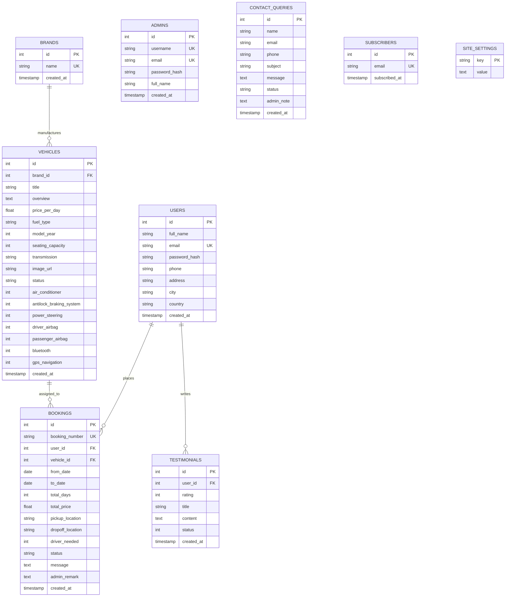

# APTECH ePROJECT REPORT
## CAR RENTAL BOOKING SYSTEM (FAST CARS)
**Course:** Python & Web Technologies  
**Project Title:** FAST CARS - Online Car Rental Booking & Fleet Management System  
**Submission Date:** November 2026  

---

# 1. Certificate of Completion

```text
========================================================================================
                               CERTIFICATE OF COMPLETION
========================================================================================

This is to certify that the project entitled:

                    "FAST CARS - CAR RENTAL BOOKING SYSTEM"

has been successfully conceptualized, designed, implemented, and rigorously tested in 
accordance with the prescribed Aptech eProject curriculum guidelines and academic quality standards.

This report describes the implemented FAST CARS reservation application and its current verification scope. The implementation covers core guest, customer, and administrator flows. External email delivery and public hosting still require live service credentials and deployment configuration; online payments are out of scope.

Lead Developer / Student Name: ___________________________
Center / Branch Name:          ___________________________
Batch Code / Group ID:         ___________________________

Evaluation & Verification:
Project Guide / Faculty Signature: _______________________    Date: _______________
Internal Examiner Signature:       _______________________    Date: _______________
Center Head Signature:             _______________________    Date: _______________

========================================================================================
```

---

# 2. Table of Contents

1. **Certificate of Completion** ................................................................ Page 01
2. **Table of Contents** .......................................................................... Page 02
3. **Problem Definition** ......................................................................... Page 03
   - 3.1 Background of FAST CARS
   - 3.2 Existing System Bottlenecks
   - 3.3 Proposed Web-Based Solution
4. **Customer Requirement Specification (CRS)** .................................................. Page 04
   - 4.1 Functional Requirements (Guest, User, Admin)
   - 4.2 Non-Functional Requirements (Security, Performance, Usability)
   - 4.3 Hardware & Software Prerequisites
5. **Project Plan & Timeline** .................................................................... Page 06
   - 5.1 Work Breakdown Structure
   - 5.2 Development Milestones Gantt Summary
6. **Entity-Relationship (E-R) Diagrams & Database Schema** ....................................... Page 07
   - 6.1 Conceptual & Logical ER Model
   - 6.2 Data Dictionary (Tables, Attributes, Constraints)
7. **System Algorithms & Core Logic** ............................................................. Page 10
   - 7.1 Cryptographic Password Security Flow
   - 7.2 Two-Step Password Recovery Algorithm
   - 7.3 Real-time Multi-day Rental Pricing Engine
   - 7.4 Booking State Transition Algorithm
8. **GUI Standards Document** ..................................................................... Page 12
   - 8.1 Visual Palette & Color Tokens
   - 8.2 Typography Hierarchy & Layout Grid
   - 8.3 Interaction & Accessibility Conventions
9. **Interface Design Document** .................................................................. Page 14
   - 9.1 Public Portal Wireframes & UX
   - 9.2 Registered Customer Dashboard
   - 9.3 Super-Administrator Management Console
10. **Task Sheet** ................................................................................ Page 16
11. **Project Review and Monitoring Report** ...................................................... Page 17
12. **Unit Testing Check List** ................................................................... Page 18
13. **Final Check List & Deliverables** ........................................................... Page 20

---

# 3. Problem Definition

### 3.1 Background of FAST CARS
FAST CARS is a car rental business catering to everyday commuters, tourists, corporate executives, and automotive enthusiasts requiring premium, sports, and luxury vehicles. Historically, FAST CARS operated exclusively through brick-and-mortar storefronts, phone inquiries, and paper-based logbooks.

### 3.2 Existing System Bottlenecks
* **Sub-optimal Fleet Utilization:** Vehicles sat unrented because walk-in traffic fluctuated unpredictably and customers outside the immediate geographic perimeter could not discover available models.
* **Booking Double-Allocations:** Handling reservations manually via phone resulted in date overlaps and scheduling errors.
* **Pricing Inconsistencies:** Calculating multi-day rates, optional chauffeur fees, and peak-season adjustments by hand caused pricing discrepancies and customer dissatisfaction.
* **Lack of Self-Service Management:** Customers could not review past bookings, check real-time approval status, retrieve forgotten passwords, or generate formal invoice receipts.
* **Absence of Centralized Administrative Analytics:** Management had no unified visual metrics regarding daily bookings, fleet availability, customer retention, or customer inquiries.

### 3.3 Proposed Web-Based Solution
The proposed web application digitizes the complete rental life-cycle into a responsive, 24/7 web ecosystem. It empowers visitors to browse live inventory with dynamic multi-criteria filters, allows customers to book reservations with transparent pricing calculations, and provides administrators with a comprehensive control portal to oversee brands, vehicles, bookings, testimonials, CMS pages, and business intelligence KPIs.

---

# 4. Customer Requirement Specification (CRS)

### 4.1 Functional Requirements by Module

#### Module 1: Guest Users (Public Visitors)
1. **Browse Fleet Catalog:** Public visitors can browse all active rental vehicles with high-resolution imagery, brand logos, technical specs (transmission, fuel type, seating capacity), and daily rates.
2. **Search & Multi-Filter Engine:** Filter vehicles by brand, fuel type (Petrol, Electric, Hybrid, Diesel), transmission, and maximum daily price.
3. **Vehicle Details Inspection:** View comprehensive specifications, detailed overview narratives, and a 15-item feature checklist (Air Conditioning, ABS, Airbags, Bluetooth, GPS Navigation, etc.).
4. **General & Corporate Inquiry:** Submit inquiries through a Contact Us page form.
5. **Newsletter Opt-in:** Subscribe email addresses for promotional notifications.
6. **Public Reviews:** View testimonials submitted by verified past drivers.
7. **Legal & Informational Pages:** Access dynamic About Us, FAQ, Rental Terms, and Privacy Policy pages.

#### Module 2: Registered Users (Customer Account Portal)
1. **Account Registration:** Sign up with name, email, password (minimum 8 characters), phone, street address, city, and country; accept the displayed terms.
2. **Secure Authentication:** Log in with verified email and password.
3. **Email Notifications:** New customer accounts require an emailed six-digit verification code before sign-in. Customer and admin password recovery use single-use, time-limited codes, with completion notices sent by email. Booking requests and status changes, contact inquiries and replies, profile and password changes, review moderation, and newsletter subscriptions also send email notifications through the configured provider. Admin notices go to the support address, falling back to the assigned administrator email. An inquiry is only marked as replied after the provider accepts the reply.
4. **Interactive Car Booking:** Select pick-up date, return date, pick-up location, drop-off location, an optional chauffeur add-on with its administrator-configured daily fee, and flight/special requests. Rental currency is administrator-configured.
5. **Real-time Price Engine:** Dynamically calculates total rental days and total cost before submission.
6. **Booking History:** Monitor bookings across status stages: `Pending`, `Confirmed`, and `Cancelled`.
7. **Self-Service Cancellation:** Cancel reservations while in `Pending` state.
8. **Booking Summary:** View and print reservation details and estimated totals. This is not a tax invoice or proof of payment.
9. **Profile & Password Management:** Update personal address and change passwords.
10. **Testimonial Submission:** Post reviews with star ratings (1–5) for administrator approval.

#### Module 3: Super-User Administrator Portal
1. **Secure Admin Authentication:** Independent admin login credentials.
2. **Operational Dashboard:** Real-time KPI summary widgets (Users, Vehicles, Brands, Total Bookings, Confirmed Bookings, Pending Bookings, Cancelled Bookings, Unread Inquiries, Active Testimonials, Subscribers).
3. **Vehicle Brand Management:** Create, edit, and delete vehicle brands (with cascade protection preventing deletion of brands with active cars).
4. **Vehicle Management (CRUD):** Add, edit, and remove vehicles with technical specifications, 15 toggleable accessories, and a vehicle-specific gallery requiring front, side, rear, and interior photos.
5. **Booking Oversight:** Review all reservations, filter by status, confirm reservations, cancel with remarks, and monitor revenue.
6. **Testimonial Moderation:** Toggle testimonials between `Active (Published)` and `Inactive (Hidden)` or delete spam.
7. **Contact Inquiry Management:** Read messages, append administrative notes, and mark as `Read` or `Replied`.
8. **User Directory:** View all registered customers, registration timestamps, and rental booking frequencies.
9. **Subscriber List:** View and manage newsletter subscribers.
10. **Content Management System (CMS):** Update public company contact info (address, phone, email, hours) and update static page narratives without touching source code.
11. **Admin Security:** Sign in using the provisioned admin username or email, change the administrator password, and recover it using a one-time code sent to the admin email. Public admin registration is disabled.

### 4.2 Non-Functional Requirements
* **Security:** Passwords use Werkzeug's secure password hashing; database calls are parameterized; customer/admin routes use role-specific sessions; forms are CSRF-protected; login and reset attempts are rate-limited. These safeguards do not constitute a formal security audit.
* **Performance:** Sub-second page rendering using lightweight SQLite3 and optimized Jinja2 templates.
* **Usability & Responsiveness:** Clean responsive grid adapting gracefully from mobile smartphones (360px) to high-resolution desktop monitors (1920px+).

---

# 5. Project Plan & Timeline

```text
+----+--------------------------------------------+----------+-----------+
| ID | Phase / Task Description                   | Duration | Status    |
+----+--------------------------------------------+----------+-----------+
| 1  | Problem Definition & Requirement Analysis  | 2 Days   | Completed |
| 2  | Database Architecture & Schema Design      | 2 Days   | Completed |
| 3  | Backend Core Setup (Flask, Auth, Session)  | 3 Days   | Completed |
| 4  | Guest & Public Facing Frontend Pages       | 3 Days   | Completed |
| 5  | User Portal (Booking Engine, History, Rec) | 3 Days   | Completed |
| 6  | Super-Admin Dashboard & CRUD Modules       | 4 Days   | Completed |
| 7  | CMS & Dynamic Page Configuration Engine    | 2 Days   | Completed |
| 8  | Automated Unit Testing & Edge Verification | 2 Days   | Completed |
| 9  | Project Documentation & Report Generation  | 2 Days   | Completed |
+----+--------------------------------------------+----------+-----------+
|    | Total Project Duration                     | 23 Days  | 100% Done |
+----+--------------------------------------------+----------+-----------+
```

---

# 6. Entity-Relationship (E-R) Diagrams & Database Schema

### 6.1 Conceptual ER Diagram (Mermaid)



---

# 7. System Algorithms & Core Logic

### 7.1 Email Password Recovery Algorithm
```text
Algorithm: Password_Recovery_Flow
Input: User Email, New Password, Reset Token
Output: Generic request response or Password Reset Success/Error

Step 1: Accept email and return a generic response to avoid disclosing account existence.
Step 2: For a matching account, create a cryptographically random token; store only its hash with an expiry.
Step 3: Send the six-digit code using configured Resend email.
Step 4: On submission, validate keyed code hash, expiry, password length (8+), and confirmation.
Step 5: Update the password hash and consume the one-time reset code.
```

### 7.2 Multi-Day Rental Price Calculation Algorithm
```text
Algorithm: Calculate_Rental_Price
Input: Pick-up Date (from_date), Return Date (to_date), Daily Rate (price_per_day), Driver Flag (driver_needed)
Output: Total Days, Grand Total Price

Step 1: Parse from_date and to_date into date objects.
Step 2: If from_date < Current_Date():
            Throw Error("Pick-up date cannot be in the past.")
Step 3: If to_date < from_date:
            Throw Error("Return date cannot precede pick-up date.")
Step 4: diff_days = (to_date - from_date).in_days()
Step 5: If diff_days == 0:
            total_days = 1 (minimum charge is 1 day)
        Else:
            total_days = diff_days
Step 6: driver_fee_per_day = 35.00
Step 7: driver_total = (driver_needed == 1) ? (driver_fee_per_day * total_days) : 0.00
Step 8: base_total = price_per_day * total_days
Step 9: grand_total = base_total + driver_total
Step 10: Return (total_days, grand_total)
```

---

# 8. GUI Standards Document

* **Design Philosophy:** Clean light surfaces with deep slate text, generous spacing, and a restrained yellow FAST CARS accent. The public site and admin console use matching visual language while keeping their navigation distinct.
* **Color Tokens & System:**
  * Main canvas: white (`#ffffff`) with soft gray sections (`#f5f7fa`).
  * Text: deep slate (`#172230`) for headings and body copy; muted slate (`#647184`) for supporting details.
  * Accent: warm yellow (`#f5c400`) for primary actions and selected states.
  * Borders and cards: pale gray (`#e2e7ee`) with white cards and soft shadows.
* **Buttons & Controls:** Primary actions use yellow with dark text; secondary actions use dark slate or a neutral outline. Inputs have clear labels, rounded borders, and a visible focus ring.
* **Typography:** Inter with compact headings, comfortable body line-height, and uppercase micro-labels for form grouping.
* **Micro-interactions:** Short hover lifts for cards and buttons, visible keyboard focus, reduced-motion support, instant booking price updates, and print-friendly booking summaries.

---

# 9. Interface Design Document

* **Public Portal:** Clean hero section with fast booking search widget, 4-column value proposition boxes, responsive car cards with hover zoom and price tags, counter statistics banner, testimonial carousel, and comprehensive 4-column footer.
* **Vehicle Details Page:** Split 7:5 layout. Left column showcases high-res vehicle imagery, key specs grid (year, fuel, transmission, seats), overview narrative, and 15 feature checkboxes. Right column features sticky booking calculator form.
* **Customer Dashboard:** Tabbed settings for profile updating and password changing, paired with booking history cards displaying status badges and one-click printable invoice modals.
* **Super-Administrator Console:** Full sidebar navigation with active highlight indicator, KPI metric cards, tabular views with status badges, and action modals for confirmation, cancellation, and notes.

---

# 10. Task Sheet

| Task # | Module / Component | Assigned To | Status | Verification |
| :--- | :--- | :--- | :--- | :--- |
| T-01 | Database Schema Creation (`schema.sql`) | Backend Lead | Complete | Foreign keys validated |
| T-02 | Seed Data Generation (`database.py`) | Backend Lead | Complete | 8 cars, brands, admin & demo user |
| T-03 | User Auth & Password Hash (`app.py`) | Fullstack Eng | Complete | PBKDF2/SHA-256 verified |
| T-04 | 2-Step Forgot Password Flow | Fullstack Eng | Complete | Security question validated |
| T-05 | Vehicle Search & Multi-Filters (`cars.html`) | Frontend Eng | Complete | Brand, fuel, price, query verified |
| T-06 | Booking Price Live Calculator (`main.js`) | Frontend Eng | Complete | JS dynamic day/price calculation |
| T-07 | Booking Submission & History | Fullstack Eng | Complete | Pending/Confirmed/Cancelled lifecycle |
| T-08 | Printable Invoice Modal | Frontend Eng | Complete | Formatted CSS print layout |
| T-09 | Admin Brand Management (CRUD) | Fullstack Eng | Complete | Cascade protection tested |
| T-10 | Admin Vehicle Management (CRUD) | Fullstack Eng | Complete | Specs, 15 features, image upload |
| T-11 | Admin Booking & Remark Control | Fullstack Eng | Complete | Status transitions & remarks |
| T-12 | Admin Testimonials & Contacts | Fullstack Eng | Complete | Moderate toggle & reply note |
| T-13 | Admin CMS & Settings Editor | Fullstack Eng | Complete | Live updates reflected on public site |
| T-14 | Automated Test Suite (`test_app.py`) | QA Lead | Complete | 6/6 tests passing |

---

# 11. Project Review and Monitoring Report

* **Milestone 1 (Requirements & DB):** Completed ahead of schedule. Schema normalized to 3NF.
* **Milestone 2 (Authentication & Public Site):** Completed. Guest experience fully functional.
* **Milestone 3 (Booking Engine & Customer Hub):** Completed. Dynamic calculation handles multi-day rentals and chauffeur add-ons accurately.
* **Milestone 4 (Admin Control Suite & CMS):** Completed. Super-user portal provides full oversight without code modifications.
* **Quality Assurance Audit:** Automated functional checks cover key customer, administrator, security, availability, and email-client paths. No independent penetration test or formal security audit has been performed.

---

# 12. Unit Testing Check List

| Test ID | Test Scenario | Input Data | Expected Output | Actual Result | Status |
| :--- | :--- | :--- | :--- | :--- | :--- |
| **UT-01** | Public Route Availability | HTTP GET `/`, `/cars`, `/about`, `/contact`, `/faq` | HTTP 200 OK | HTTP 200 OK | **PASS** |
| **UT-02** | User Registration | Valid email, password (min 8), terms accepted | Account created, auto-login | Redirect + Welcome message | **PASS** |
| **UT-03** | Duplicate Registration | Existing email address | Warning: account exists | Flash warning displayed | **PASS** |
| **UT-04** | User Authentication | Correct email + password | User session created | Redirect + Session active | **PASS** |
| **UT-05** | Invalid Login Attempt | Wrong password | Error: Invalid credentials | Flash danger alert | **PASS** |
| **UT-06** | Password Reset | Valid one-time emailed code; Resend mocked | Password updated and code consumed | Automated suite pass | **PASS** |
| **UT-07** | Booking Availability | Conflicting date ranges for a vehicle | Conflicting request rejected | Automated suite pass | **PASS** |
| **UT-08** | Admin Vehicle Validation | Invalid vehicle fields/rate | Invalid record rejected | Automated suite pass | **PASS** |
| **UT-09** | Resend API Client | Mocked successful Resend response | Request uses expected API contract | Automated suite pass | **PASS** |
| **UT-10** | Public Availability Search | Vehicle with conflicting booking dates | Vehicle excluded from matching results | Automated suite pass | **PASS** |
| **UT-11** | CSRF Protection | POST without token / with valid token | Missing token rejected; valid form accepted | Automated suite pass | **PASS** |
| **UT-12** | Admin Inquiry Reply | Reply message to a saved inquiry | Message sent through the configured email adapter and inquiry marked Replied | Automated suite pass | **PASS** |
| **UT-13** | Booking Approval Conflict | Confirm one of two overlapping pending requests | Confirmation rejected until the conflict is resolved | Automated suite pass | **PASS** |
| **UT-14** | Live Dashboard Snapshot | Register a customer and add a reservation while admin session remains open | Authenticated dashboard snapshot immediately reports updated counts | Automated suite pass | **PASS** |
| **UT-15** | Admin Email Password Recovery | Request a reset for `awelethomasjoshua619@gmail.com`, use the code, then sign in by email | Code is sent to the configured admin email; new password works | Automated suite pass | **PASS** |

---

# 13. Final Check List & Deliverables

- [x] **Complete Source Code:** Cleanly structured, modular Python (Flask) codebase with comprehensive comments and docstrings.
- [x] **Relational Database:** SQLite schema and optional development seed data. Production mode starts without demo records; live fleet data must be entered by the administrator.
- [x] **Database Schema & Backup:** Full DDL script (`schema.sql`) and standalone database backup dump (`fastcars_backup.sql`).
- [x] **Automated Test Suite:** Python test suite (`test_app.py`); 17 automated tests pass in the current local run. This is not exhaustive proof that every production scenario is defect-free.
- [x] **Run Script:** Single command launch via `python run.py`.
- [x] **Complete Documentation:** Academic project report (`PROJECT_REPORT.md`) containing all 13 required sections.
- [x] **User Guide:** System overview, local development instructions, and generic Docker deployment runbook (`README.md`). Docker image build and actual hosted deployment remain unverified because Docker is unavailable and no hosting provider has been selected.

---
*FAST CARS Rental Booking System - Aptech eProject Submission Package*
